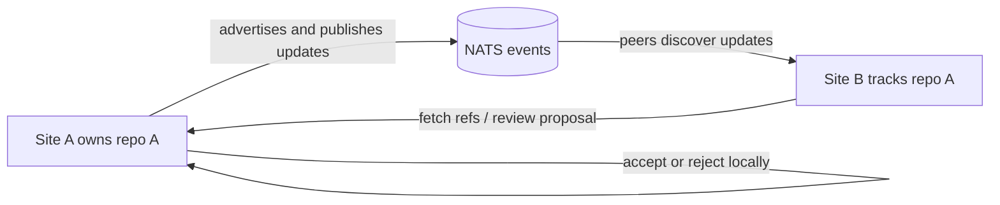

# ref-based-fed

### Git federation for sites that need to work together—and keep working apart.

`ref-based-fed` is an experimental federation agent that lets independent sites exchange Git changes while each site keeps authority over its own repository. It uses Git refs and bundles for change transfer, and NATS for discovery and event notifications.

**Local authority. Disconnected-friendly workflows. No central Git host required.**

> **Status: proof of concept.** The project is actively exploring the federation workflow; expect rough edges and evolving behavior.

## How it works



Each site owns and updates its authoritative repository. Peers can follow that site, fetch published refs, and submit proposals. The owner reviews incoming changes and decides whether to accept them; accepted changes can then be announced for peers to fetch. Git stores the repository content and refs. NATS carries the coordination messages.

```text
peer change ──> proposal ref ──> owner review ──> accept/reject
                                      │
                         accepted update announced to peers
```

## Why refs?

Federation state can be represented with ordinary Git refs: published state, remote tracking state, and proposal/inbox state stay distinct. Git bundles can carry proposal history when sites cannot connect continuously. This keeps the model close to standard Git while allowing each site to operate independently.

The project explores a **DDIL-friendly** (disconnected, intermittent, and limited connectivity) workflow without quorum or a single master site. It is not a multi-writer shared branch: authority stays with the repository's owning site.

## Try the local multi-site demo

The Makefile provides a local lab with multiple Gitea sites, the Rust federation agents, and a proposal review UI. You’ll need Rust with Cargo, Docker Compose, Node.js/npm, and GNU Make.

```bash
make demo
```

This recreates the demo environment and starts the sites and UIs. Open the site UIs at `http://127.0.0.1:5173` onward (one port per site). To stop the demo and remove its environment and logs:

```bash
make demo-down
```

For manual control, start the lab, then run a site agent and its UI in separate terminals:

```bash
make up
make site1
make ui1
```

The site agent API defaults to port `8081`; the UI uses port `5173` and proxies API requests to the agent. Site-specific targets include `make site2`, `make ui2`, and `make farewell2`. Run `make help` to see available targets. Demo credentials and port settings can be adjusted through Make variables; see the [Makefile](Makefile).

## Follow policy

Each managed repository can use `.federation/following` to control which sites it follows. A missing file defaults to following all sites; an empty file follows none. Add one site name per line to choose specific peers. A matching advertisement supplies the repository URL needed to add a remote.

See [Following Remote Sites](docs/following.md) for the full rules and behavior.

## Project boundaries

This is a federation workflow POC, not a forge or a replacement for GitHub, GitLab, or Forgejo. It does not implement a globally writable multi-master branch or distributed consensus. The demo uses Gitea instances to provide familiar repository and review interfaces.

## Documentation

- [Federation flow](docs/federation-flow.md) — publishing, peer synchronization, and proposal workflows
- [Following remote sites](docs/following.md) — `.federation/following` policy and remote reconciliation
- [Farewell demo](docs/demos/farewell.md) — demonstrate a site leaving and rejoining the lab
- [Post-push payload example](docs/post-push-payload-example.json) — sample webhook payload consumed by the agent

## Built with

- **Rust** for the federation agent and HTTP API
- **Git** refs and bundles for repository state and change transfer
- **NATS** for federation events
- **React + Vite** for the proposal review UI
- **Gitea** for the local multi-site demo

---

Contributions, experiments, and feedback are welcome. Start with the [federation flow](docs/federation-flow.md) to understand the model, then try the local demo.
