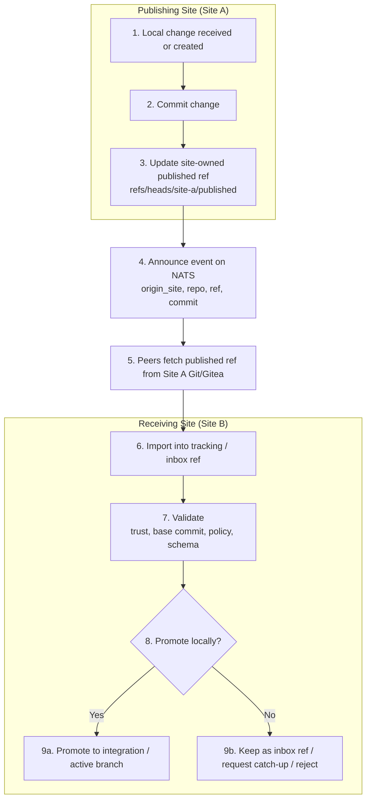
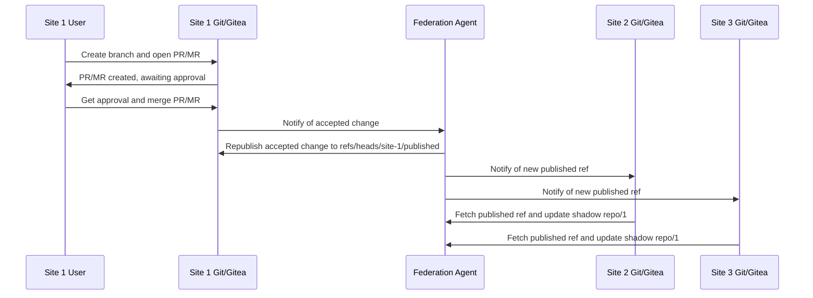
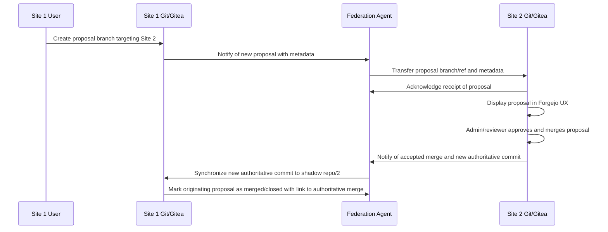

# Federation Flow: Leveraging Git Refs

## Federation Flow Diagram

## User stories

### User Story 1: Site 1 changes its own repo

- User at Site 1 creates branch in local repo/1
- Opens PR / MR at Site 1
- Gets approval
- Merges into authoritative repo/1
- Federation agent republishes accepted change
- Site 2 and Site 3 update their shadow repo/1
- Remote sites become up to date for awareness and future proposals

#### Sequence diagram for User Story 1

### User Story 2: Site 1 proposes change to Site 2

- Site 1 user works in a local workspace derived from Site 2’s current shadow repo/2
- Site 1 opens a remote proposal targeting Site 2’s authoritative repo/2
- Federation agent transfers proposal branch/ref and metadata to Site 2
- Site 2 sees it in native Forgejo UX
- Site 2 admin/reviewer approves and merges locally
- Site 2’s accepted merge becomes authoritative
- Resulting commit is synchronized back to Site 1 shadow repo/2
- Originating proposal is marked merged/closed with link to authoritative merge

#### Sequence diagram for User Story 2

